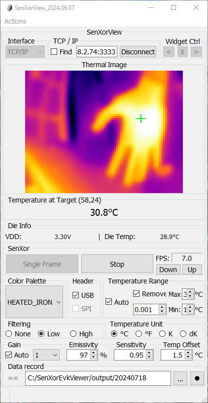

# Thermal-ESP32-Demo

ESP32-S3 firmware with web-based real-time thermal imaging preview (Meridian Innovation SenXor).

## Flashing

Single merged firmware file:

| File | Address |
|------|---------|
| `firmware/factory.bin` | 0x0000 |

```bash
esptool.py --port <COM> write_flash 0x0000 firmware/factory.bin
```

## Connection

**AP Mode** (default):
- SSID: `WSThermal`
- Password: `12345678`
- Open: `http://192.168.4.1/thermal`

**STA Mode**:
- Edit `CONFIG_ESP_WIFI_STA_SSID` / `CONFIG_ESP_WIFI_STA_PASSWORD` in `sdkconfig`
- Access `http://<device-ip>/thermal`

## Web Pages

| Page | URL | Description |
|------|-----|-------------|
| Thermal | `/thermal` | Live heatmap with 4 colormaps, auto/manual range, FPS counter |
| Raw Data | `/thermal/raw` | 80x62 temperature value matrix |
| Debug | `/thermal/debug` | Sensor registers and frame status |

## License

MIT. SenXorLib (c) Meridian Innovation.


## Sample Output
### SenXorEVKViewer streaming thermal image:
<p align="left">
     
</p>

