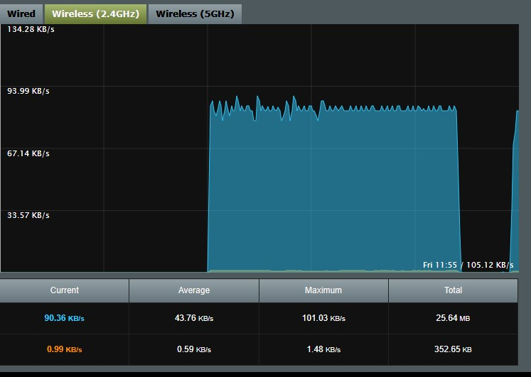

# Thermal-ESP32-Demo

ESP32-S3 firmware with web-based real-time thermal imaging preview (Meridian Innovation SenXor).

## Flashing

Single merged firmware file:

| File | Address |
|------|---------|
| `firmware/factory.bin` | 0x0000 |

```bash
esptool.py --port <COM> write_flash 0x0000 firmware/factory.bin
```

## Connection

**AP Mode** (default):
- SSID: `WSThermal`
- Password: `12345678`
- Open: `http://192.168.4.1/thermal`

**STA Mode**:
- Edit `CONFIG_ESP_WIFI_STA_SSID` / `CONFIG_ESP_WIFI_STA_PASSWORD` in `sdkconfig`
- Access `http://<device-ip>/thermal`

## Web Pages

| Page | URL | Description |
|------|-----|-------------|
| Thermal | `/thermal` | Live heatmap with 4 colormaps, auto/manual range, FPS counter |
| Raw Data | `/thermal/raw` | 80x62 temperature value matrix |
| Debug | `/thermal/debug` | Sensor registers and frame status |

## License

MIT. SenXorLib (c) Meridian Innovation.


## Sample Output
### SenXorEVKViewer streaming thermal image:
<p align="left">
     
</p>

### Thermal images shown on the iOS App
<p align="left">
     
</p>

### Bandwidth 
Test environment:
1. Station Mode
2. 802.11n Access point with 2.40GHz and 20MHz bandwidth WiFi connection
3. Distance between ESP32S3 and access point is less than 1 metre
4. Only client, EPS32S3 and a PC (via ethernet cable) are connected to the access point

Typical bandwidth usage is estimated to 90KB/s - 101KB/s, as shown in below figure:

<p align="left">
     
</p>


## Troubleshooting

1. PSRAM error is displayed on console
	Ensure that PSRAM are configurated** as follow. 
	The configuration can be changed via `sdkconfig`
	*For details, please refer to https://docs.espressif.com/projects/esp-idf/en/latest/esp32s3/api-reference/kconfig.html*

	**Location in sdkconfig:**
	`Component config` > `ESP PSRAM` 
	PSRAM must be configurated as follow:

	| PSRAM Pin  | ESP32-S3-EYE  | ESP32-S3 DevKitC-1  |
	| ------------ | ------------ | ------------ |
	|Accessing Mode   |Octal Mode   |Quad Mode   |

2. Incorrect SSID and password is entered and applied to ESP32
	ESP32 will attempt to connect the the station specified by the user. It will retry until the limit (default: 5) is reached.
	When the limit is reached, the ESP32 will wait for user to set an new station SSID and attempt to connect.
	Because ESP32's WiFi runs under AP + Station mode as well as Bluetooth enabled, user can configure ESP32 remotely via Android App.
	User can also use the Android App to reset ESP32

3. ESP32 is not found in Bluetooth
	Ensure Bluetooth controller and BluFi function are enabled in `sdkconfig`.
	Checked if the Bluetooth in Android device is Bluetooth LE capable.

4. Changing ESP32 Bluetooth's device name
   Please use the Android Configuration App to change the device Bluetooth name.

## REFERENCE
1. ESP-IDF Programming guide

	https://docs.espressif.com/projects/esp-idf/en/latest/esp32s3/index.html
2. ESP32S3 WiFi Driver configuration

	https://docs.espressif.com/projects/esp-idf/en/latest/esp32s3/api-reference/network/esp_wifi.html

3. ESP32S3 Hardware reference (e.g. Datasheet, schematics...)

	https://docs.espressif.com/projects/esp-idf/en/latest/esp32s3/hw-reference/index.html
4. Using VSCode ESP-IDF extension

	https://github.com/espressif/vscode-esp-idf-extension/blob/master/docs/tutorial/install.md

## DISCLAIMER
**FOR DEMOSTRATION PURPOSE ONLY**

**ALL DATA FROM SenXor ARE SOLELY FOR REFERENCE ONLY**


**Revision date** 

18th July 2024